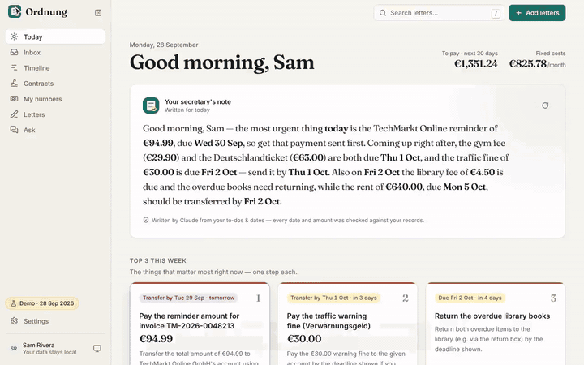
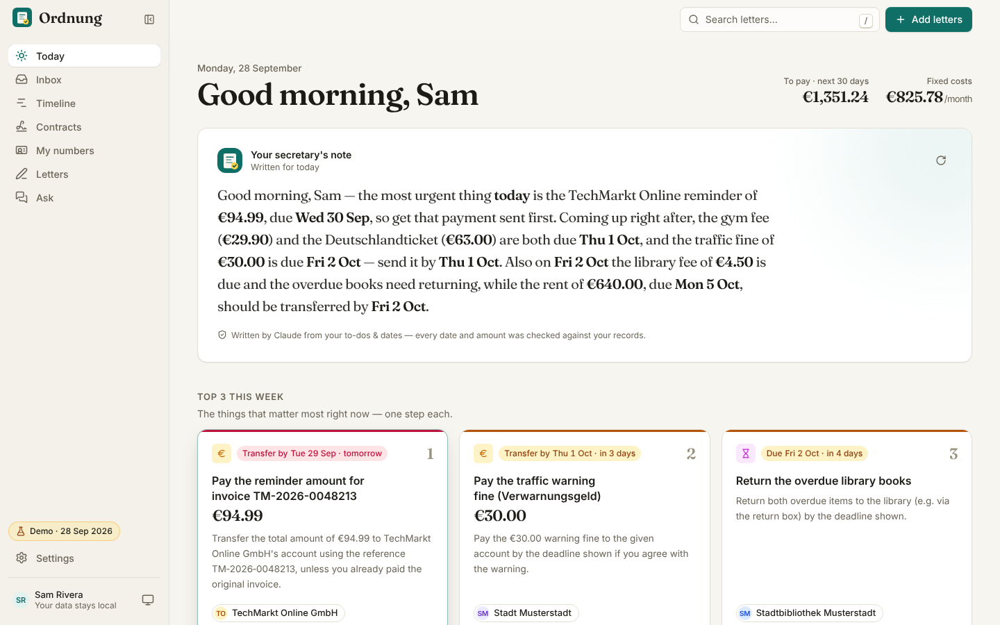
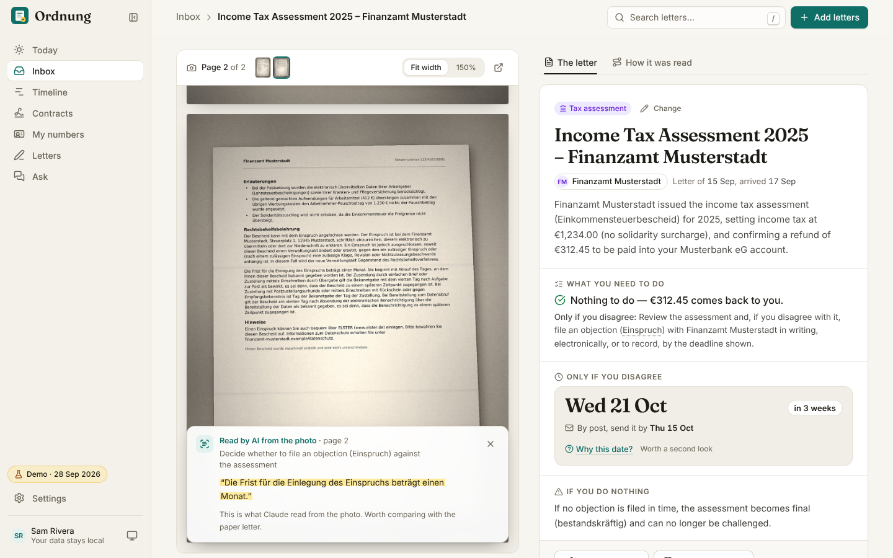
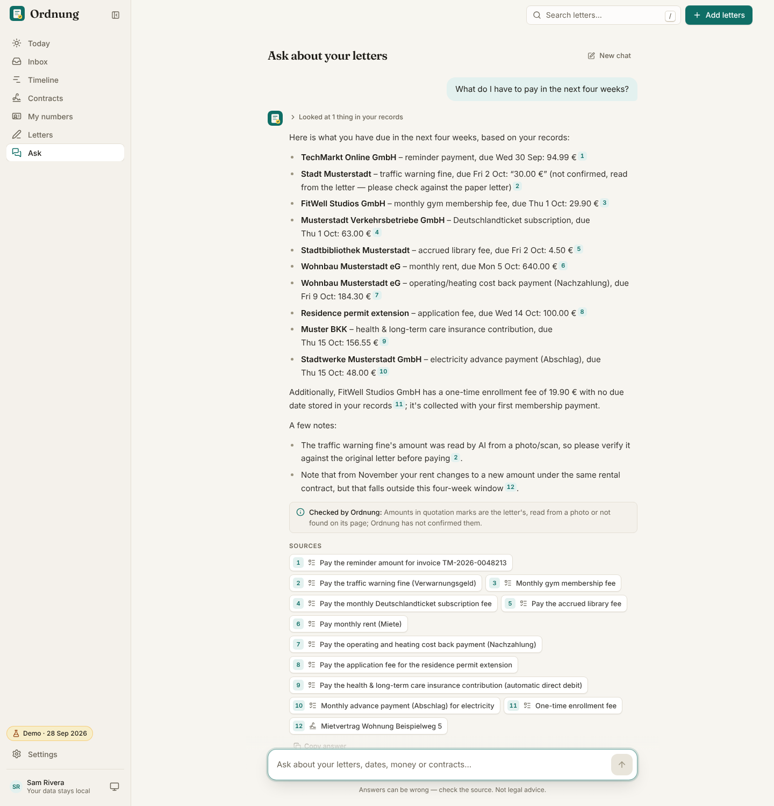
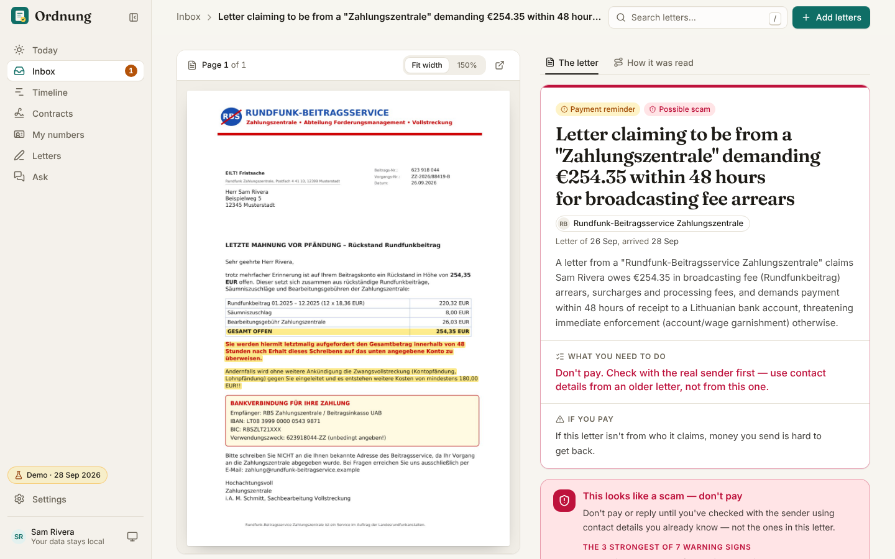
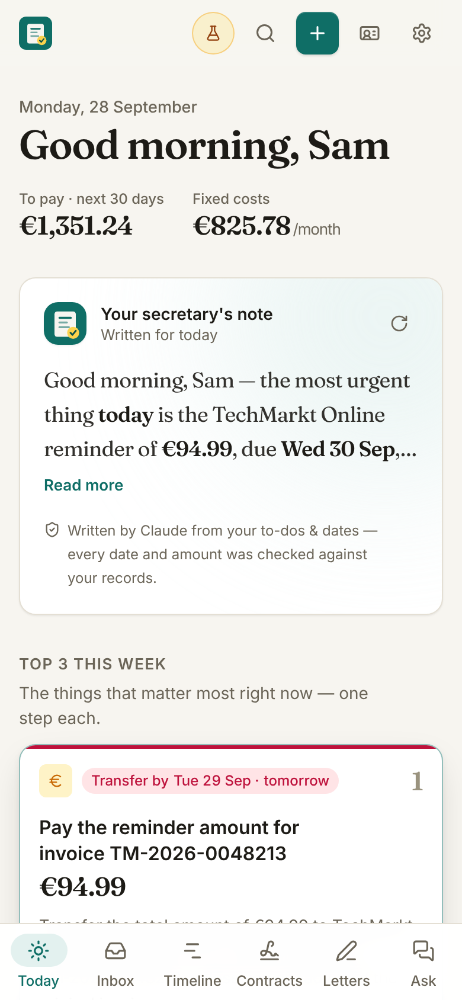
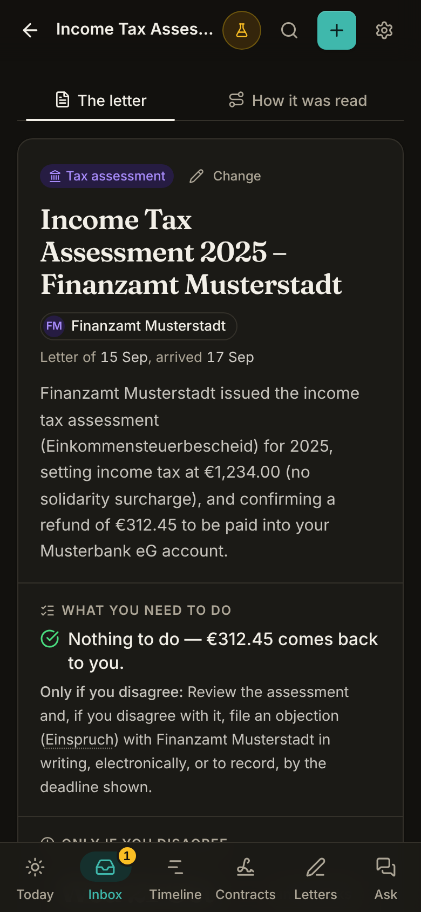

<p align="center">
  
</p>

<h1 align="center">Ordnung</h1>

<p align="center">
  <b>A private secretary for the paperwork of life in Germany.</b><br>
  Claude reads your letters; tested code works out each deadline and shows the law behind it. Ordnung
  reminds you before things matter, drafts the replies and runs on your own computer.
</p>

<p align="center">
  <a href="https://github.com/ahmedEid1/ordnung/actions/workflows/ci.yml"></a> 
   <a href="LICENSE"></a>
</p>

<p align="center">
  <br>
  <a href="https://ahmedeid1.github.io/ordnung/"><b>Open the online demo</b></a> (nothing to install) ·
  <a href="docs/assets/demo.mp4">Watch the whole tour (MP4, 1 min 33 s)</a><br>
  <sub>The court order in both comes from the browser-only demo's sample letters (<code>?mock=full</code>); its date and advice card are the rules engine's.</sub>
</p>

<p align="center"><a href="#what-it-does">What it does</a> · <a href="#install-and-run">Install</a> · <a href="#evaluation">Evaluation</a> · <a href="#engineering">Engineering</a> · <a href="#documentation">Docs</a></p>

Everyone living in Germany gets letters with deadlines: tax assessments, fines, rent increases, contract changes,
reminders, court orders. The deadline is rarely a date on the page. It is *"one month after this notice is announced
to you"*, and working it out means knowing that a posted notice counts as delivered on the fourth day (since 2025),
that tax law moves that day off a weekend but administrative law does not, and that holidays depend on the federal
state. **Ordnung** lets Claude read the letter and say what it says; deterministic, tested code turns that into the
date, shows its working with citations, and keeps a ledger you can ask about. Nothing is ever paid, sent or cancelled
for you. Whether that beats asking the model is [measured](#evaluation), and every number replays with no API key.

## What it does

- **Reads your letters** from a PDF, a phone photo or a saved e-mail (`.eml`, or Outlook's `.msg`): what each one is,
  what to do, by when and what happens if you ignore it, each fact linked to its sentence and explained in your
  language (English, German, Arabic, Turkish, Ukrainian, Spanish or French).
- **Computes the real deadline** with a tested rules engine (deemed delivery, §§ 187–193 BGB, federal-state holidays,
  notice periods) and shows every step with its legal source under *Why this date?*.
- **Reminds you in time:** Today's three things that matter this week, a ten-minute weekly review, and a calendar file
  with alarms (or CalDAV sync) and a morning notification that work while the browser is closed.
- **Helps you act, never acts for you:** bilingual drafts and DIN 5008 PDFs whose legally operative sentences come from
  fixed templates, proof of sending, and a GiroCode your banking app scans.
- **Answers with citations, and resists tricks:** *Ask* checks every date and amount against the record it cites;
  scam signs flag a letter; text hidden in a PDF or written to steer an AI is shown, never followed.
- **Goes where you are**, once you turn it on: your phone over your home Wi-Fi, and your other computer through a
  folder your own sync tool keeps in step, with only encrypted files in it.

<table>
<tr>
<td width="50%"><br><b>Today.</b> A secretary's note, the three things that matter this week with countdowns, and Ideas with reasons.</td>
<td width="50%"><br><b>Every letter.</b> What to do and by when, each fact linked to the sentence it came from. This one was read from a phone photo.</td>
</tr><tr>
<td><br><b>Ask.</b> Answers about your letters, every date and amount checked against the record it cites.</td>
<td><br><b>Scam and injection defence.</b> Scam signs such as pressure or a payee account abroad flag a letter. Its dates still show on its page and in the warning, but stay off Today, the calendar and the notification until you choose <i>I checked — it's genuine</i>; it never gets a GiroCode.</td>
</tr>
</table>

<p align="center"> &nbsp; </p>
<p align="center"><b>Light and dark.</b> Both themes have no serious or critical violations of axe 4.14's WCAG 2.2 AA rules, with one documented exemption, and every page works from 320 px wide up; CI checks both.</p>

## Install and run

**Nothing to install:** the [online demo](https://ahmedeid1.github.io/ordnung/) is the same interface in your browser,
on the browser-only demo's version of the sample letters, with no server behind it; it keeps nothing once you reload.

**On your computer, with zero tokens:** `ordnung demo` opens the sample life of *Sam Rivera*, an international
student in the fictional town of Musterstadt: 25 letters, contracts, a residence permit, a scam, and
three unopened letters in the *New mail* tray. Every model answer in it is a recording of a real Claude run, so it
needs no Claude account. You need Git, Python 3.11 or newer, and [uv](https://docs.astral.sh/uv/) or pipx:

```bash
uv tool install git+https://github.com/ahmedEid1/ordnung # or: pipx install git+https://github.com/ahmedEid1/ordnung
ordnung demo                                             # opens http://127.0.0.1:8766 with a guided tour
ordnung serve                                            # your own letters, on http://127.0.0.1:8765
```

Reading your own letters needs Claude Code 2.1.0 or newer, signed in with a paid Claude plan or an Anthropic Console
account. [The guide](docs/guide.md#install-and-run) sets it up and covers words in photos, the app-menu shortcut, your
phone, your other computer, Claude Desktop and [the environment variables](docs/guide.md#environment-variables).

### Updating

`ordnung --version` shows yours, and [CHANGELOG.md](CHANGELOG.md) what changed. [Updating](docs/guide.md#updating) in
the guide says how to update, and how to go back.

## Evaluation

Is it better to let code do the date arithmetic than to ask the model? Ordnung is measured against the same pinned
model used three other ways: on its own (*LLM only*), with the rules pasted into its prompt (*LLM + rules text*), and
as an agent that calls Ordnung's engine as a tool (*LLM + rules tool*). A deadline counts as right only on its exact
date, and as harmful when it comes out late or not at all. Every comparison is paired on the same deadlines: exact
McNemar tests, a sign-flip test over letter clusters, and Holm's correction across the three comparisons.

<!-- evals:begin: generated by `python -m evals.present`; do not edit -->
**Held out, read once.** On 168 deadlines in 189 synthetic letters that nothing was tuned on, Ordnung dates
**97.0 %** exactly right (95 % CI 93.2–99.0), with **3 of 168** late or missed. The same model doing the date
arithmetic itself gets **81.0 %** (31 vs 4 discordant, exact p < 0.001), with **13** late or missed. An agent given
Ordnung's engine as a tool scores 99.4 % (1 vs 5 discordant): we cannot tell whether Ordnung is within 5 points of
it (−2.4 points, 95 % CI −5.4 to +0.0).

<picture><source media="(prefers-color-scheme: dark)" srcset="docs/assets/eval-held-out-dark.svg"></picture>

**Where it falls short:** “Please check” caught 0 of Ordnung's 5 wrong dates; 15 of 224 real obligations got no reminder because their letter was set aside as a scam; 2 of 12 scam letters still put their demands in the calendar.<br>
**Ask:** 40 of 44 answers right (38 of 44 strictly correct): the four wrong answers call a date that is still open passed, the recording day leaking in as today; 6 of 73 answers (questions and attacks) are harmful, all six calling a date that is still open passed; 0 of 21 injected claims reach you (9 of 21 without the answer check); 4 of 5 household answers say whose a number is; a development set, not held out.<br>
**[Full evaluation report →](https://ahmedeid1.github.io/ordnung/evals/)** statistics, baselines, safety, failures and cost · [as Markdown](docs/evals.md) · [reproduce it with no API key](docs/evals.md#15-reproduce)
<!-- evals:end -->

Why these numbers can be checked:

- **Held out.** The headline counts only synthetic German letters (PDFs and phone photos) written before anything was
  recorded on them, by agents that saw neither the reading code, the prompts nor any result; nothing was tuned on them.
- **Generated, never typed.** `python -m evals.present` writes the block above from the results files. CI fails when
  one character of it differs, and a test fails when this README types one of the results' rates or counts outside it.
- **Replayable at zero tokens.** `make eval-reproduce` replays every published number from the recorded answers, with
  no API key, and checks each against a hashed index ([`INDEX.json`](evals/results/INDEX.json)) where a date that
  moved must name the change that moved it. CI runs it on every pull request.
- **Baselines, stated plainly.** One gives the model Ordnung's own engine as a tool: an agent that decides when to
  call it and whether to trust it. The tuning effort was unequal, in Ordnung's favour
  ([§ 4](docs/evals.md#4-conditions-and-baselines)), and the report switches each of Ordnung's code checks, and Ask's
  answer check, off in turn ([§ 8](docs/evals.md#8-ablations)).
- **Pre-registered next.** These statistics were chosen after the results were known, so they are not pre-registered.
  The final run, on letters written after the code freeze, will be pre-registered before it is recorded, and its
  result takes this headline by its rule, whatever it shows.

## Engineering

### The model reads, code computes

For the photographed tax assessment above, Claude returns only what the letter says. This is part of its recorded
answer:

```json
{ "kind": "deadline",
  "title": "Decide whether to file an objection (Einspruch) against the assessment",
  "date": { "type": "relative", "anchor": "deemed_delivery", "amount": 1, "unit": "months",
            "delivery_rule": "de_admin_post", "nature": "objection", "shift_rule": "auto",
            "text": "Die Frist für die Einlegung des Einspruchs beträgt einen Monat." },
  "quote": "Die Frist für die Einlegung des Einspruchs beträgt einen Monat." }
```

Code finds the quote in the letter's text (here, Claude's transcript of the photo), then the rules
engine turns the reading into a date and a receipt, shown in the app under *Why this date?*:

| Step | Date | Rule |
|---|---|---|
| Posting day: the letter's date (the real posting day can only be later) | Tue 15 Sep 2026 | § 122 (2) AO |
| Counts as delivered on the 4th day after posting | Sat 19 Sep | § 122 (2) no. 1 AO, four days since 2025 (PostModG) |
| A Saturday, so delivery moves to the next working day | Mon 21 Sep | BFH IX R 68/98, § 108 (3) AO |
| One month later | **Wed 21 Oct 2026** | §§ 187, 188 BGB |
| Post it by, allowing four working days for the letter to arrive | Thu 15 Oct | safety margin |

The same sentence from a city office gives Mon 19 Oct: under § 41 VwVfG the deemed delivery day does not move off a
Saturday. The engine also covers social-law delivery, consumer contracts, rent, employment, fines and the rare letters
that are costly to miss, such as a court payment order or a dismissal; in doubt it picks the earliest plausible date.
[docs/deadline-rules.md](docs/deadline-rules.md) gives every rule with its source.

### Trust boundaries

| Boundary | What guards it |
|---|---|
| Letter → Claude | The letter is wrapped as untrusted data, the reading runs with no tools, and its answer must fit a JSON schema. Text hidden in a PDF is detected and shown, never followed. |
| Claude → your records | A fact is `verified` only when its sentence is on the page with the same digits, and a date whose sentence isn't there is marked *Please check* ([ADR 0003](docs/decisions/0003-grounding-levels.md)). The model never computes a date. |
| Your records → Ask | Ask reads only through read-only MCP tools on a read-only connection, and has no date calculator. Every date, time or amount in an answer must cite a record that holds it, and that check runs before you see the answer ([ADR 0008](docs/decisions/0008-two-channels-and-claim-level-citations.md), [ADR 0011](docs/decisions/0011-ask-keeps-to-the-ledger.md)). |
| Ordnung → the world | It never pays, sends or cancels anything. A GiroCode only pre-fills a transfer you confirm in your banking app, and the legally operative sentences in letters come from fixed templates ([ADR 0006](docs/decisions/0006-read-only-agent-and-humble-automation.md), [ADR 0012](docs/decisions/0012-girocode-only-for-grounded-transfers.md)). |
| Your computer → Anthropic | Through your own Claude Code: a letter's text or page images when it is read, and what Ask, *Weekly Ideas*, the secretary's note and *Letters* each need ([what each sends](docs/privacy.md#what-is-sent-to-claude-per-feature)). |
| Browser → server | `127.0.0.1` only, a one-time sign-in link and a session cookie, Fetch-Metadata and Origin checks, a strict CSP. |

### Architecture

```text
your letters      ──▶  Claude, through your own   ──▶  Ordnung's code            ──▶  you
PDF · photo ·          Claude Code: reads each         finds each quote on the        web app · CLI · phone ·
e-mail · folder        letter with no tools and        page, computes each date       Ask: Claude again, on read-only
                       answers in JSON                 with the rules engine and      MCP tools, every value checked
                                                       files it in SQLite             before you see it
```

Python 3.11+ with FastAPI, Typer, Pydantic and SQLite (WAL, FTS5 full-text search); a React 19, TypeScript, Vite,
Tailwind CSS v4 and TanStack Query web app. Ordnung handles no API key: the model runtime is your own Claude Code in
headless mode, stream-json in and out with JSON-schema output ([ADR 0001](docs/decisions/0001-claude-cli-as-the-model-runtime.md)).

### Tested

- **12,000+ backend tests** (Hypothesis property tests of the rules engine, a fake `claude` executable, API contract
  tests), **2,200+ Vitest tests** and **500+ Playwright tests** over the demo and the real app with a fake Claude,
  with axe accessibility checks in light and dark mode.
- **The rules engine** has 100 % line and branch coverage, enforced in CI, and `mypy` strict on it, as on the whole
  package and the benchmark code.
- **A typed API contract:** `make openapi` writes the FastAPI schema and the web app's TypeScript types; a backend test
  fails when either is stale, and Vitest checks every API call and mock response against the schema, strictly.
- **Agents, MCP and tracing:** Ask is an agent over read-only ledger tools; the deadline engine is an MCP server of
  its own (`ordnung mcp install` sets it up for Claude Desktop or Claude Code); `ordnung trace --otel` exports how a
  letter was read as OpenTelemetry with the GenAI conventions, without letter text or names.
- **CI on every pull request:** ruff, mypy, ESLint and `tsc`; the backend tests on Python 3.11, 3.12, 3.13 and 3.14;
  Vitest and Playwright; the wheel installed and run outside the checkout; a dependency audit; the web build checked
  against its sources; both benchmarks replayed with no model call; and `ordnung demo --check`, which rebuilds the
  demo twice and requires identical contents ([ADR 0004](docs/decisions/0004-replay-fixtures-and-deterministic-ids.md)).

## Privacy

Your files and your database stay on this computer. When Claude reads a letter, that letter's text or image is sent
to Anthropic through your own Claude account (Claude Code, the Claude program you installed and signed in to).
Ordnung has no server, no telemetry and never sees your credentials. Phone access, calendar sync and sync between your
computers stay off until you turn them on. [docs/privacy.md](docs/privacy.md) says what each feature sends, and
[what to do](docs/privacy.md#if-your-computer-is-lost-or-stolen) if your computer is lost or stolen.

## Limitations

- Built for Germany: letters from other countries are read and filed, but their dates are taken as written.
- Not legal advice: the rules were researched against statutes and case law and checked against worked examples, but
  not reviewed by a lawyer. Court deadlines always come with a "get advice" warning.
- The app's own text is in English; what Claude writes for you follows the language you choose.
- The benchmark letters are synthetic and real post is messier; phone access and hand-off sync were tested in
  emulation and with a simulated sync tool, not yet on physical phones or two physical computers.

[The guide](docs/guide.md#limitations) lists every limitation; the evaluation report has [its own](docs/evals.md#14-limitations).

## How it was built

Ordnung was built in Claude Code sessions, with Claude Code as a pair programmer that ran parallel agents for research,
implementation and review. Correctness came from outside the model: the law was researched against statutes, court
decisions and administrative guidance; the engine is unit- and property-tested with full branch coverage; the reading
was measured on a held-out benchmark against baselines; and every model answer the demo shows is a recording of a real
run. Where reviewer agents kept finding new cases in a heuristic, it was replaced by a short written policy
([ADR 0007](docs/decisions/0007-short-written-policies-over-growing-heuristics.md)).

## Documentation

- **Using it:** [the guide](docs/guide.md) ([a tour](docs/guide.md#a-tour), [install and run](docs/guide.md#install-and-run), [updating](docs/guide.md#updating), [environment variables](docs/guide.md#environment-variables), [limitations](docs/guide.md#limitations)) and [privacy](docs/privacy.md)
- **How it works:** [architecture](docs/architecture.md), [deadline rules](docs/deadline-rules.md), [design decisions](docs/decisions/README.md), [the specification](docs/SPEC.md)
- **The evaluation:** [the report](docs/evals.md), [the Ask benchmark](docs/evals-ask.md), [the benchmark code](evals/README.md)
- **Working on it:** [CONTRIBUTING.md](CONTRIBUTING.md), [SECURITY.md](SECURITY.md), [CHANGELOG.md](CHANGELOG.md), and [every document by reader](docs/README.md)

## Disclaimer

Ordnung is not a law firm and gives no legal advice. Deadlines it computes are estimates with the reasoning shown so
you can check them. All organisations, people and letters in the demo are fictional and marked SPECIMEN.

MIT licensed. See [LICENSE](LICENSE). Postcode data © [GeoNames](https://www.geonames.org/),
[CC BY 4.0](https://creativecommons.org/licenses/by/4.0/), reduced to the states of each postcode
([`LICENSE-GeoNames.txt`](src/ordnung/rules/data/LICENSE-GeoNames.txt)). The web app bundles open-source packages and
the Inter and Fraunces fonts under their own licences (MIT, ISC and the SIL Open Font License 1.1); their notices ship
with it in [`THIRD-PARTY-NOTICES.txt`](src/ordnung/web/dist/THIRD-PARTY-NOTICES.txt), written when the web app is
built. The Python packages Ordnung runs on are not bundled: pip installs each with its own licence.
