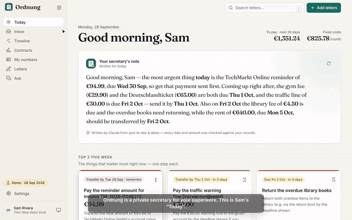
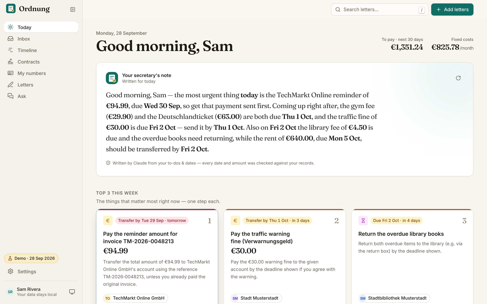
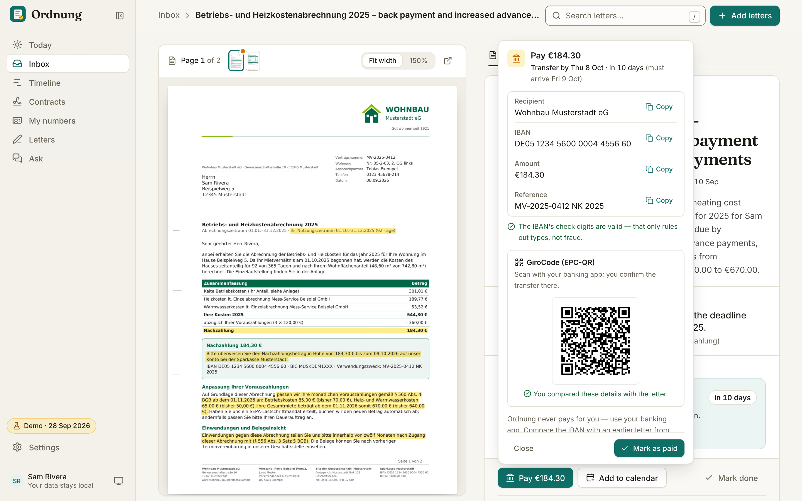
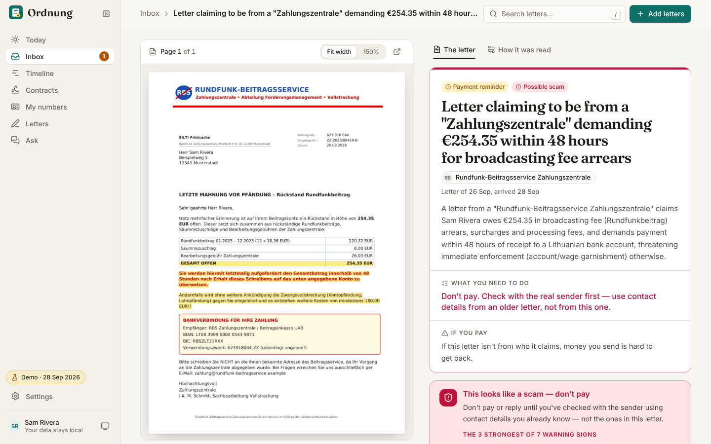

<p align="center"></p>

<h1 align="center">Ordnung</h1>

<p align="center"><b>A private secretary for the paperwork of life in Germany.</b><br>
  Claude reads your letters; tested code works out each deadline and shows the law behind it. Ordnung
  reminds you before things matter, drafts the replies and runs on your own computer.</p>

<p align="center"><a href="https://ahmedeid1.github.io/ordnung/"><b>Open the online demo</b></a> (nothing to install) · <a href="docs/assets/demo.mp4">Watch the whole tour (MP4, 1 min 28 s)</a> · <a href="#install-and-run">Install</a> · <a href="#privacy">Privacy</a></p>

<p align="center"><picture><source type="image/webp" srcset="docs/assets/demo.webp"></picture><br>
  <sub>The court order in the video (not in the animation) is a sample letter written for the online demo, not one Claude read; its date and advice card come from the rules engine.</sub></p>

## The model reads, code computes

A German letter rarely gives its deadline as a date. It says *"one month after this notice is announced to you"*,
and the law decides the day.

> *„Die Frist für die Einlegung des Einspruchs beträgt einen Monat.“*<br>
> <sub>A photographed tax assessment in the demo, dated Tue 15 Sep 2026: one month to object.</sub>

One month from when? Claude quotes the sentence; the rules engine works out the date, step by step:

| Date | Step, and its law |
|---|---|
| Tue&nbsp;15&nbsp;Sep | Posting day: the letter's date (the real posting day can only be later)<br><sub>§ 122 (2) AO</sub> |
| Sat&nbsp;19&nbsp;Sep | Counts as delivered on the 4th day after posting<br><sub>§ 122 (2) no. 1 AO, four days since 2025 (PostModG)</sub> |
| Mon&nbsp;21&nbsp;Sep | The 19th is a Saturday, so delivery moves to the next working day<br><sub>BFH IX R 68/98, § 108 (3) AO</sub> |
| **Wed&nbsp;21&nbsp;Oct** | **One month later: the deadline**<br><sub>§§ 187, 188 BGB</sub> |
| Thu&nbsp;15&nbsp;Oct | Send by: four working days earlier, for the post<br><sub>safety margin</sub> |

From a city office the same sentence gives **Mon 19 Oct**: § 41 VwVfG does not move delivery off a Saturday.

Ordnung reminds you in time. It never pays, sends or cancels anything for you.

<details>
<summary>What Claude returned, and what the engine does when in doubt</summary>

Part of Claude's recorded answer for this letter. Code finds the quote in the letter's text (here, Claude's
transcript of the photo) before the engine turns the reading into the date above:

```json
{ "kind": "deadline",
  "title": "Decide whether to file an objection (Einspruch) against the assessment",
  "date": { "type": "relative", "anchor": "deemed_delivery", "amount": 1,
    "unit": "months", "delivery_rule": "de_admin_post",
    "nature": "objection", "shift_rule": "auto",
    "text": "Die Frist für die Einlegung des Einspruchs beträgt einen Monat." },
  "quote": "Die Frist für die Einlegung des Einspruchs beträgt einen Monat." }
```

The engine also covers social-law delivery, consumer contracts, rent, employment, fines and the rare letters
that are costly to miss, such as a court payment order or a dismissal; in doubt it picks the earliest plausible
date, except where a fact only you know decides (when a matter in Baden-Württemberg, Bavaria or
Mecklenburg-Vorpommern began): a warning names the earlier date.
[docs/deadline-rules.md](docs/deadline-rules.md) gives every rule with its source.

</details>

## Install and run

- **In your browser:** the [online demo](https://ahmedeid1.github.io/ordnung/) runs the same interface on
  hand-written sample letters, with no server behind it; it keeps nothing once you reload.
- **On your computer, free:** `ordnung demo` opens a sample life in fictional Musterstadt: 25 letters, with
  three unopened letters in *New mail*. Its model answers are recordings of real runs: no Claude account needed.
- **Your own letters:** Claude Code 2.1.0 or newer, with a paid Claude plan or an Anthropic Console account
  ([the guide](docs/guide.md#install-and-run) sets it up).

You need Git, Python 3.11 or newer, and [uv](https://docs.astral.sh/uv/) or pipx:

```bash
uv tool install git+https://github.com/ahmedEid1/ordnung
# or: pipx install git+https://github.com/ahmedEid1/ordnung
ordnung demo     # opens http://127.0.0.1:8766 with a guided tour
ordnung serve    # your own letters, on http://127.0.0.1:8765
```

### Updating

`ordnung --version` shows yours. How to update or go back: [the guide](docs/guide.md#updating); what changed: [CHANGELOG.md](CHANGELOG.md).

## What it does

<table><tr>
<td width="50%" valign="top"><br><b>Every letter.</b> What to do and by when.</td>
<td width="50%" valign="top"><br><b>Today.</b> What matters this week.</td>
</tr><tr>
<td valign="top"><br><b>Pay by scan.</b> A GiroCode pre-fills a transfer you confirm in your banking app.</td>
<td valign="top"><br><b>A scam, flagged.</b> Its dates still show on its page and in the warning, but stay off Today, the calendar and the notification until you choose <i>I checked — it's genuine</i>; it never gets a GiroCode.</td>
</tr></table>

- **Answers your questions:** *Ask* checks every date and amount against the record it cites before you see it.
- **Helps you act, never acts for you:** draft replies, letters in the German layout (DIN 5008), proof of sending.
- **Goes where you are, once you turn it on:** your phone over your home Wi-Fi, your other computer through your
  own sync folder, with only encrypted files in it.

<p align="center"> &nbsp; <br><sub><b>Light and dark.</b> Both themes have no serious or critical violations of axe 4.14's WCAG 2.2 AA rules, with one exemption (the page image's highlight buttons, under WCAG 2.5.8's "equivalent" exception). <a href="docs/guide.md#a-tour">The tour</a> shows more.</sub></p>

## Privacy

**Your files and your database stay on this computer. When Claude reads a letter, that letter's text or image is
sent to Anthropic through your own Claude account** (Claude Code, the Claude program you installed and signed in
to). Ordnung has no server, no telemetry and never sees your credentials. Phone access, calendar sync and sync
between your computers stay off until you turn them on. [docs/privacy.md](docs/privacy.md) says what each feature
sends, and [what to do](docs/privacy.md#if-your-computer-is-lost-or-stolen) if your computer is lost or stolen.

## Limitations

- **Built for Germany:** letters from other countries are read and filed, but their dates are taken as written.
- **Not legal advice:** the rules were researched against statutes and case law and checked against worked
  examples, but not reviewed by a lawyer. Court deadlines always come with a "get advice" warning.
- **English interface:** the app's own text is in English; what Claude writes follows the language you choose
  (English, German, Arabic, Turkish, Ukrainian, Spanish or French).
- **Synthetic benchmark letters:** real post is messier.
- **Phone access and hand-off sync:** tested in emulation and with a simulated sync tool, not yet on physical
  phones or two physical computers.
- **More:** [every limitation](docs/guide.md#limitations) and [the evaluation's limitations](docs/evals.md#14-limitations).

*That is all you need to start; the rest is for readers who want to check the work.*

## How it works

<p align="center"><picture><source media="(prefers-color-scheme: dark)" srcset="docs/assets/pipeline-dark.svg"></picture></p>

Built with Python, FastAPI and SQLite, and a React and TypeScript web app. Ordnung handles no API key: the model
runs in your own Claude Code ([ADR 0001](docs/decisions/0001-claude-cli-as-the-model-runtime.md)). Every part:
[docs/architecture.md](docs/architecture.md).

### Trust boundaries

A letter is untrusted data, read with no tools. The model never computes a date, Ask only reads, and Ordnung never
pays, sends or cancels anything.

<details>
<summary>All seven boundaries and what guards each</summary>

| Boundary | What guards it |
|---|---|
| Letter → Claude | Wrapped as untrusted data, read with no tools, the answer held to a JSON schema; hidden text Ordnung finds in a PDF is kept from Claude and shown to you as a scam sign (one layer, not a guarantee). |
| Claude → your records | A fact is `verified` only when its sentence is on the page with the same digits; a date without its sentence is marked *Please check* ([ADR 0003](docs/decisions/0003-grounding-levels.md)). |
| Your records → Ask | Read-only MCP tools on a read-only connection, no date calculator; every date, time or amount must cite a record that holds it, checked before you see it ([ADR 0008](docs/decisions/0008-two-channels-and-claim-level-citations.md), [ADR 0011](docs/decisions/0011-ask-keeps-to-the-ledger.md)). |
| Ordnung → the world | A GiroCode only pre-fills a transfer you confirm in your banking app; legally operative sentences come from fixed templates ([ADR 0006](docs/decisions/0006-read-only-agent-and-humble-automation.md), [ADR 0012](docs/decisions/0012-girocode-only-for-grounded-transfers.md)). Calendar sync sends dates, times and alarms, with no letter's title, name or amount unless you choose *With details*; hand-off sync writes only encrypted files to your sync folder. |
| Your computer → Anthropic | Through your own Claude Code: a letter's text or page images, and what Ask and the other writing features need ([what each sends](docs/privacy.md#what-is-sent-to-claude-per-feature)). |
| Browser → Ordnung on your computer | `127.0.0.1` only, a one-time sign-in link and a session cookie, Fetch-Metadata and Origin checks, a strict CSP. |
| Phone → Ordnung (opt-in) | Adds a second listener: HTTPS on one home-network address, answering only phones you paired with a one-time code (anything else gets only the pairing page), and never their requests for settings, backups or deletion ([ADR 0017](docs/decisions/0017-phone-access-over-the-home-network.md)). |

</details>

### Tested

<a href="https://github.com/ahmedEid1/ordnung/actions/workflows/ci.yml"></a> <br>
**6,000+ backend tests**, **2,200+ Vitest tests** and **450+ Playwright tests**; the rules engine has 100 % line and
branch coverage, enforced in CI.

<details>
<summary>What the tests cover, and every CI job</summary>

- **The rules engine:** Hypothesis property tests, and `mypy` strict on it, as on the whole package and the
  benchmark code.
- **Fakes, never the model:** a fake `claude` in the backend tests and in Playwright's real-app project; Playwright
  also runs over the demo, with axe in light and dark mode; Vitest covers the web app's units.
- **A typed API contract:** `make openapi` writes the FastAPI schema and the web app's types; a test fails when
  either is stale, and Vitest checks every API call and mock response against the schema.
- **MCP and tracing:** the deadline engine is an MCP server of its own (`ordnung mcp install`); `ordnung trace
  --otel` exports how a letter was read as OpenTelemetry, without letter text or names.
- **CI on every pull request:** ruff, mypy, ESLint and `tsc`; the backend tests on Python 3.11, 3.12, 3.13 and 3.14;
  Vitest and Playwright; the wheel installed and run outside the checkout; a dependency audit.
- **And on every pull request:** the web build checked against its sources; both benchmarks replayed with no model
  call; `ordnung demo --check`, which rebuilds the demo twice and requires identical contents
  ([ADR 0004](docs/decisions/0004-replay-fixtures-and-deterministic-ids.md)).

</details>

## Evaluation

**Does letting code do the date arithmetic beat asking the model?** Ordnung is measured against the same pinned
model alone (*LLM only*), with the rules pasted in (*LLM + rules text*) and as an agent using Ordnung's engine as a
tool (*LLM + rules tool*). A deadline is right only on its exact date, harmful if late or missed.

Paired tests: a sign-flip test over letter clusters with Holm within each family and a bootstrap interval, a
non-inferiority bound against the agent, and McNemar's mid-p for how steady the dates are.

<!-- evals:begin: generated by `python -m evals.present`; do not edit -->
**Final run, pre-registered.** On 112 deadlines in 126 synthetic letters written after the code freeze, each read 3
times by the version that ships, Ordnung dates **92.9 %** exactly right (95 % CI 87.0–97.4); the same model doing
the date arithmetic itself, the model alone, gets **87.8 %**. Ordnung against the model alone: no clear difference
(+5.1 points, 95 % CI −2.4 to +12.2; power about 93 %). Deviations from the pre-registration, recorded at the time
and listed in `evals/preregistration/deviations-0.4.0.json`: 14. Ordnung against the model with the rules pasted in,
which gets 97.9 %: a difference of −5.1 points not confirmed by the pre-registered test (Holm p = 0.180; 95 % CI
−11.0 to −0.3). An agent given Ordnung's engine as a tool, the agent, gets 98.8 % and is ahead of Ordnung (−6.0
points for Ordnung, 95 % CI −11.1 to −1.1; answers not exactly right over every read: Ordnung 24, the agent 4). Late
or missed dates in 336 answers per condition: 4 from Ordnung, 22 from the model alone, 6 from the model with the
rules pasted in and 4 from the agent. Late or missed dates, Ordnung against the model alone: a difference of −5.4
points not confirmed by the pre-registered test (Holm p = 0.100; 95 % CI −10.3 to −1.2). Late or missed dates,
Ordnung against the model with the rules pasted in: no clear difference (−0.6 points, 95 % CI −2.3 to +0.6; power
about 0 %). Over the 3 reads, a date changed between reads on fewer deadlines for Ordnung than for the model alone
(1 against 18 of 112; Holm mid-p < 0.001); 3 for the model with the rules pasted in and 1 for the agent.

<picture><source media="(prefers-color-scheme: dark)" srcset="docs/assets/eval-final-dark.svg"></picture>

**Where it falls short:** Wrong dates from Ordnung over every read: 8; its “please check” flag caught 0 of them. From the letter file to the reminder, on the final letters read once: 128 of 140 real deadlines got a reminder in time; 7 got none because their letter was set aside as a scam, until the person confirms it is genuine. 1 of 6 scam letters still put their demands in the calendar.<br>
“Ask: new questions on the demo household”, first run: 65 of 84 answers strictly right and 7 of 160 harmful; 18 harmful in any of the 3 runs; 4 of 60 injected claims reached an answer in the worst of the 3 runs. “Ask: new questions on the demo household” holds out only its questions: its documents, prompt and scorer were tuned on the same household's development questions.<br>
On 23 of 112 deadlines the label rests on a disputed reading of the law that the engine's documentation shares; with any defensible reading accepted, exactly right: Ordnung 99.7 %, the model alone 96.1 %, the model with the rules pasted in 99.4 %, the agent 100.0 %.<br>
No deadline, offered date or contract date of the final letters is left open between two or more dates by the letter or the law.<br>
The letters and their labels were written and audited by a Claude model, run through Claude Code, that is not the benchmarked model but comes from its family. Letters written by a model of that family may be easier for it to read than real mail, so every condition's absolute accuracy may be higher than on real letters.<br>
**[Full evaluation report →](https://ahmedeid1.github.io/ordnung/evals/)** every pre-registered sentence, decided or not, with the statistics, baselines, safety, failures and cost · [as Markdown](docs/evals.md) · [reproduce it with no API key](docs/evals.md#15-reproduce)
<!-- evals:end -->

### Why these numbers can be checked

- **Held out (written after the results).** The final run's letters were written after the code freeze by agents
  that saw neither the reading code, the prompts nor any result; nothing was tuned on them.
- **Not in the block (written after the results).** The block counts the letters of new kinds end to end but does not give their benchmark result ([§ 6.1](docs/evals.md#61-the-final-run)), nor why the deadlines it does not put down to a scam got no reminder ([§ 13](docs/evals.md#13-from-a-letter-to-a-reminder)).
- **Generated, never typed.** `python -m evals.present` writes the block above from the results files; CI fails when
  one character differs.
- **Replayable at zero tokens.** `make eval-reproduce` replays every published number with no API key, on every pull
  request; where today's code gives another value, the [index](evals/results/INDEX.json) pins it and names the change.
- **Baselines, stated plainly.** The agent decides when to call Ordnung's engine and whether to trust it; Ordnung got
  more tuning ([§ 4](docs/evals.md#4-conditions-and-baselines)); [§ 8](docs/evals.md#8-ablations) measures Ordnung
  with each of its checks switched off in turn.
- **Pre-registered (written after the results).** Its tests and rules were fixed before recording, in
  [#54](https://github.com/ahmedEid1/ordnung/issues/54). Recorded on real 17 Nov 2026 with the clock 7 days ahead
  (K29): recording and analysis dates are the day the model was told; deviation times, commits and PRs are real.

## How it was built

Ahmed Hobeishy built it with Claude Code as a pair programmer, with parallel agents for research, implementation
and review. Correctness came from outside the model: researched law and tests; a held-out benchmark measured the reading.

## Documentation

[Guide](docs/guide.md) · [Privacy](docs/privacy.md) · [Architecture](docs/architecture.md) ·
[Deadline rules](docs/deadline-rules.md) · [Decisions](docs/decisions/README.md) · [Evaluation](docs/evals.md) ·
[Contributing](CONTRIBUTING.md) · **[All documents](docs/README.md)**

## Disclaimer

Ordnung is not a law firm and gives no legal advice: its deadlines are estimates, with the reasoning shown so you
can check them. The demo's organisations, people and letters are fictional and marked SPECIMEN.

<sub>MIT licensed ([LICENSE](LICENSE)). Postcode data © [GeoNames](https://www.geonames.org/),
[CC BY 4.0](https://creativecommons.org/licenses/by/4.0/), reduced to the states of each postcode
([`LICENSE-GeoNames.txt`](src/ordnung/rules/data/LICENSE-GeoNames.txt)). The web app bundles open-source packages and
the Inter and Fraunces fonts under their own licences (MIT, ISC, BSD-3-Clause and the SIL Open Font License 1.1);
their notices ship with it in [`THIRD-PARTY-NOTICES.txt`](src/ordnung/web/dist/THIRD-PARTY-NOTICES.txt), written when
the web app is built. The Python packages Ordnung runs on are not bundled: pip installs each with its own licence.</sub>
